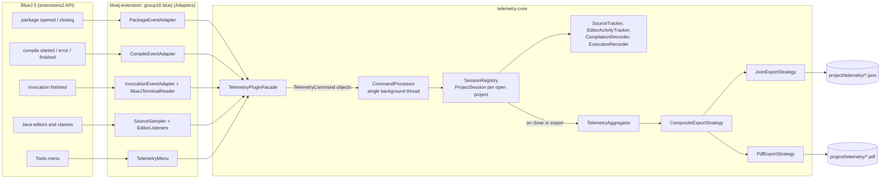
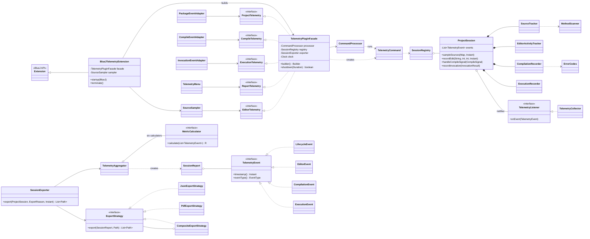
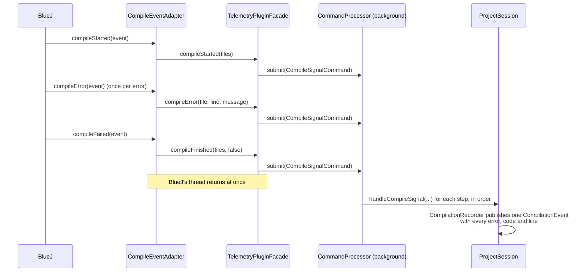
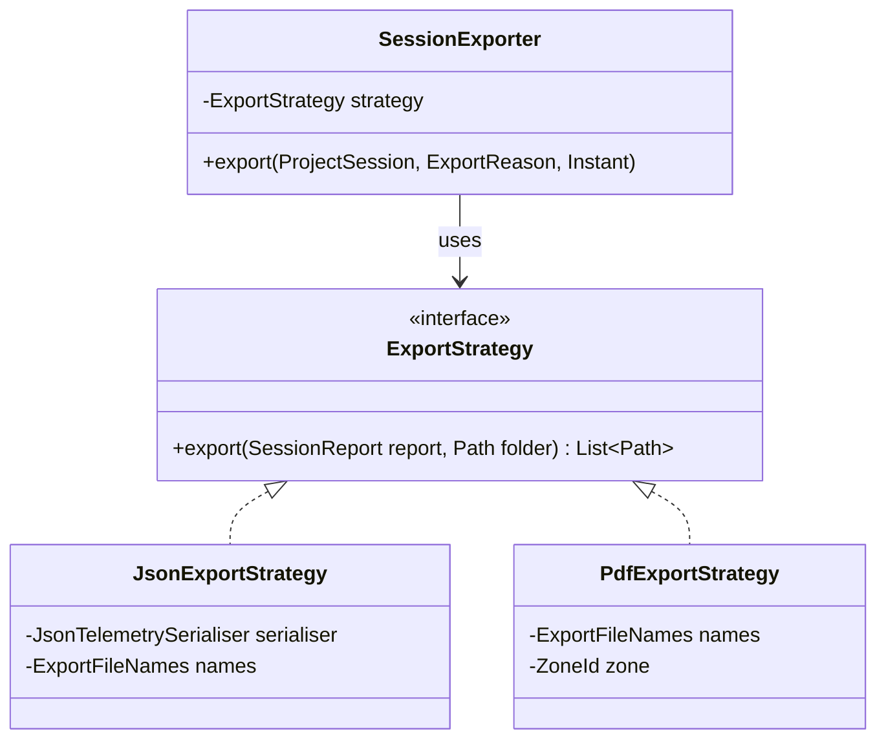
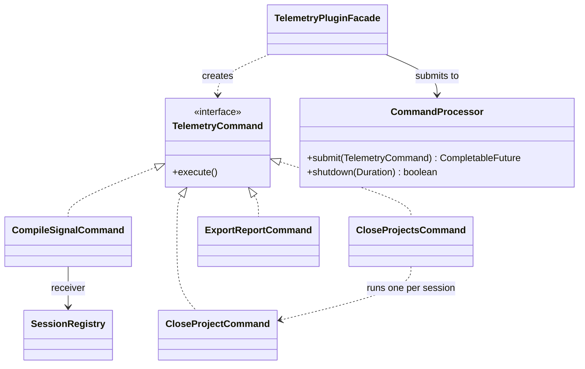

# Design
## 1. Architecture

The code is split into two Maven modules so that everything except the BlueJ glue can be built and tested without
BlueJ:

* **`telemetry-core`** has no BlueJ dependency. It holds the models, listeners, analysis, exporters, commands,
  sessions and the facade, and all of the tests.
* **`bluej-extension`** contains only the classes that touch the BlueJ API (package `group18.bluej`). It depends on
  `telemetry-core`; `telemetry-core` never depends on it.



### Packages

| Module | Package | Responsibility | Main types |
|---|---|---|---|
| core | `group18.model` | Immutable data: events and report | [`TelemetryEvent`][TelemetryEvent], [`LifecycleEvent`][LifecycleEvent], [`EditorEvent`][EditorEvent], [`CompilationEvent`][CompilationEvent], [`ExecutionEvent`][ExecutionEvent], [`SessionReport`][SessionReport] |
| core | `group18.listener` | Turn raw BlueJ data into events | [`SourceTracker`][SourceTracker], [`MethodScanner`][MethodScanner], [`EditorActivityTracker`][EditorActivityTracker], [`CompilationRecorder`][CompilationRecorder], [`ExecutionRecorder`][ExecutionRecorder], [`ErrorCodes`][ErrorCodes] |
| core | `group18.analytics` | Report figures and event observers | [`TelemetryAggregator`][TelemetryAggregator], [`TelemetryListener`][TelemetryListener], [`TelemetryCollector`][TelemetryCollector] |
| core | `group18.analytics.calculators` | One calculator per report figure | [`MetricCalculator`][MetricCalculator], `TimeMetricsCalculator`, `EditingMetricsCalculator`, `CompilationMetricsCalculator`, `ExecutionMetricsCalculator`, `LifecycleMetricsCalculator`, `TimelineCalculator` |
| core | `group18.export` | Writing reports | [`ExportStrategy`][ExportStrategy], [`JsonExportStrategy`][JsonExportStrategy], [`PdfExportStrategy`][PdfExportStrategy], [`CompositeExportStrategy`][CompositeExportStrategy] |
| core | `group18.command` | Queued requests | [`TelemetryCommand`][TelemetryCommand], [`CommandProcessor`][CommandProcessor], eight concrete commands |
| core | `group18.session` | Per-project state | [`ProjectSession`][ProjectSession], [`SessionRegistry`][SessionRegistry], [`SessionExporter`][SessionExporter], [`OutputDirectories`][OutputDirectories] |
| core | `group18.facade` | Entry point for BlueJ | [`TelemetryPluginFacade`][TelemetryPluginFacade] and five role interfaces |
| core | `group18.demo` | Scripted sessions for samples and tests | [`DemoScenario`][DemoScenario], [`DemoSession`][DemoSession] |
| extension | `group18.bluej` | BlueJ glue | [`BlueJTelemetryExtension`][BlueJTelemetryExtension] and the adapters |

## 2. Class diagram of the solution



### What happens when the student compiles



## 3. Design patterns

Seven patterns are used. Singleton is not used anywhere: every object is created and passed in explicitly.

### 3.1 Strategy: interchangeable report formats

**Where:** [`ExportStrategy`][ExportStrategy] is the strategy interface; [`JsonExportStrategy`][JsonExportStrategy]
and [`PdfExportStrategy`][PdfExportStrategy] are concrete strategies; [`SessionExporter`][SessionExporter] is the
context that uses one without knowing which.



```java
// group18/export/ExportStrategy.java: the strategy
public interface ExportStrategy {
    List<Path> export(SessionReport report, Path outputDirectory) throws IOException;
}

// group18/session/SessionExporter.java: the context only knows the interface
public List<Path> export(ProjectSession session, ExportReason reason, Instant at) throws IOException {
    session.flush(at);                                                     // close the open activity interval
    SessionReport report = aggregator.aggregate(session.info(), session.events(), at, reason);
    return strategy.export(report, directories.forSession(session.info())); // JSON? PDF? both? it doesn't know
}
```

**Second use: report figures.** [`TelemetryAggregator`][TelemetryAggregator] does not calculate anything itself.
It holds one [`MetricCalculator`][MetricCalculator] per part of the summary (time, editing, compilation, execution,
lifecycle, timeline) and only combines their results:

```java
// group18/analytics/calculators/MetricCalculator.java
public interface MetricCalculator<R> {
    R calculate(List<TelemetryEvent> events);
}

// group18/analytics/TelemetryAggregator.java
CompilationSummary compilations = compilation.calculate(ordered);
ReportSummary summary = new ReportSummary(time.calculate(ordered), editing.calculate(ordered), compilations,
        execution.calculate(ordered), lifecycle.calculate(ordered));
```

A calculator can be swapped through the aggregator's second constructor, for example to change how idle time is
defined, and each calculator is tested on its own ([`TelemetryAggregatorTest`][TelemetryAggregatorTest]).

**Benefits:** a new format (CSV, HTML) is one new class; nothing else changes. The tests plug in a lambda strategy
that records the report instead of writing files ([`CommandsTest`][CommandsTest]), so command and session logic is
tested without touching the disk.

### 3.2 Composite: several formats treated as one

**Where:** [`CompositeExportStrategy`][CompositeExportStrategy] is an `ExportStrategy` that contains other
`ExportStrategy` objects. The facade's builder combines JSON and PDF into one composite.

```java
// group18/facade/TelemetryPluginFacade.java (Builder)
return new CompositeExportStrategy()
        .add(new JsonExportStrategy(new JsonTelemetrySerialiser(), names))
        .add(new PdfExportStrategy(names, zone));

// group18/export/CompositeExportStrategy.java
public List<Path> export(SessionReport report, Path outputDirectory) throws IOException {
    List<Path> written = new ArrayList<>();
    IOException failure = null;
    for (ExportStrategy child : children) {           // each child may itself be a composite
        try {
            written.addAll(child.export(report, outputDirectory));
        } catch (IOException | RuntimeException e) {   // keep going: a PDF problem must not lose the JSON
            if (failure == null) { failure = new IOException("One or more report formats could not be written", e); }
            else { failure.addSuppressed(e); }
        }
    }
    if (failure != null) { throw failure; }
    return written;
}
```

**Benefits:** `SessionExporter` treats one format and many formats the same way. Each format runs even if another
fails, and every failure is still reported ([`CompositeExportStrategyTest`][CompositeExportStrategyTest]).

### 3.3 Command: BlueJ requests queued and run in order

**Where:** [`TelemetryCommand`][TelemetryCommand] is the command interface; the invoker is
[`CommandProcessor`][CommandProcessor]; the client is [`TelemetryPluginFacade`][TelemetryPluginFacade]; the
receivers are [`SessionRegistry`][SessionRegistry], [`ProjectSession`][ProjectSession] and
[`SessionExporter`][SessionExporter]. Concrete commands: `OpenProjectCommand`, `CloseProjectCommand`,
`CloseProjectsCommand` (a macro command that runs a `CloseProjectCommand` per session), `SampleSourcesCommand`,
`TextEditCommand`, `CompileSignalCommand`, `ExecutionCommand`, `ExportReportCommand`.



```java
// group18/facade/TelemetryPluginFacade.java: the client time-stamps the request and queues it
public CompletableFuture<Void> compileError(Path file, int lineNumber, String message) {
    return processor.submit(new CompileSignalCommand(registry,
            CompileSignal.error(file, lineNumber, message, clock.instant())));
}

// group18/command/CompileSignalCommand.java: the command knows its receiver
public void execute() {
    List<ProjectSession> targets = registry.owning(signal.files());   // project that owns the file
    // ... falls back to the session that is mid-compilation
    for (ProjectSession session : targets) {
        session.handleCompileSignal(signal);
    }
}

// group18/command/CommandProcessor.java: the invoker runs commands one at a time, in order
public CompletableFuture<Void> submit(TelemetryCommand command) {
    CompletableFuture<Void> result = new CompletableFuture<>();
    executor.execute(() -> run(command, result));   // single-thread executor
    return result;
}
```

**Benefits:**

* BlueJ calls the plugin on its user-interface thread. Writing a PDF there would freeze BlueJ; as a command it runs
  in the background.
* All session data is touched by one thread only, so no locks or synchronisation are needed anywhere.
* A failing command is logged and reported through its future; later commands still run
  ([`CommandProcessorTest`][CommandProcessorTest]).
* The macro command `CloseProjectsCommand` reuses `CloseProjectCommand` for "BlueJ is closing" and "projects that are
  no longer open".

### 3.4 Adapter: BlueJ's listener interfaces to the plugin's own interface

**Where:** [`PackageEventAdapter`][PackageEventAdapter] (BlueJ `PackageListener` to `ProjectTelemetry`),
[`CompileEventAdapter`][CompileEventAdapter] (`CompileListener` to `CompileTelemetry`),
[`InvocationEventAdapter`][InvocationEventAdapter] (`InvocationFinishedListener` to `ExecutionTelemetry`) and
[`EditorListeners`][EditorListeners] (`DocumentListener` to `EditorTelemetry`). `BlueJProjects` converts BlueJ's
`BProject` into the plugin's own `ProjectRef`.

```java
// group18/bluej/CompileEventAdapter.java
final class CompileEventAdapter implements CompileListener {          // the interface BlueJ calls (adaptee side)
    private final CompileTelemetry telemetry;                          // the interface the plugin offers (target)

    @Override
    public void compileError(CompileEvent event) {
        if (event.isUserGeneratedCompilation()) {                      // ignore BlueJ's background error checks
            List<Path> files = files(event);                           // File[] -> List<Path>
            telemetry.compileError(files.isEmpty() ? null : files.get(0), event.getErrorLineNumber(),
                    event.getErrorMessage());
        }
    }
    // compileStarted, compileSucceeded and compileFailed are adapted the same way
}
```

**Benefits:** the BlueJ API appears in one package only, so the whole core is tested without BlueJ, and a change in
BlueJ's API affects only the adapters. Decisions such as "only user-requested compilations count" live in one place.

BlueJ's listener registration (`bluej.addCompileListener(...)`) is also the Observer pattern, with BlueJ as the
subject and the adapters as observers.

### 3.5 Facade: one simple entry point to the subsystem

**Where:** [`TelemetryPluginFacade`][TelemetryPluginFacade]. Behind about ten simple methods it hides the command
queue, the session registry, the trackers, the aggregator and the exporters. It implements five small role
interfaces, one per kind of caller.

```java
// group18/bluej/BlueJTelemetryExtension.java: the BlueJ side only ever talks to the facade
bluej.addPackageListener(new PackageEventAdapter(facade));          // sees ProjectTelemetry
bluej.addCompileListener(new CompileEventAdapter(facade));          // sees CompileTelemetry
bluej.addInvocationFinishedListener(new InvocationEventAdapter(facade, new BlueJTerminalReader()));
bluej.setMenuGenerator(new TelemetryMenu(facade));                  // sees ReportTelemetry

// group18/facade/TelemetryPluginFacade.java: closing a project hides a command, the registry,
// the aggregator and two exporters behind one call
public CompletableFuture<List<Path>> projectClosed(String projectKey) {
    CloseProjectCommand command = new CloseProjectCommand(registry, exporter, projectKey,
            ExportReason.PROJECT_CLOSED, clock.instant());
    return processor.submit(command).thenApply(done -> command.writtenFiles());
}
```

**Benefits:** the adapters stay tiny; timestamps are taken in one place; and the same facade drives the demo
sessions and the end-to-end tests ([`TelemetryPluginFacadeTest`][TelemetryPluginFacadeTest]) exactly as BlueJ does.

### 3.6 Observer: sessions notify listeners of every event

**Where:** [`ProjectSession`][ProjectSession] is the subject; [`TelemetryListener`][TelemetryListener] is the
observer interface; [`TelemetryCollector`][TelemetryCollector] is the observer that stores events for reports. A
second observer counts compilations and runs as activity for the active/idle calculation.

```java
// group18/session/ProjectSession.java
listeners.add(collector);                                   // stores the events
listeners.add(event -> {                                    // compiling and running count as activity
    if (event instanceof CompilationEvent || event instanceof ExecutionEvent) {
        activity.noteActivity(event.timestamp());
    }
});

public void record(TelemetryEvent event) {
    for (TelemetryListener listener : listeners) {          // notify every observer
        listener.onEvent(event);
    }
}
```

**Benefits:** the session does not need to know what happens to its events. New reactions (for example a live
event counter, or periodic backups) are new listeners registered with `addListener`, with no change to the
session ([`TelemetryCollectorTest`][TelemetryCollectorTest]).

### 3.7 Builder: configuring the facade

**Where:** [`TelemetryPluginFacade.Builder`][TelemetryPluginFacade]. Every setting has a default (system clock,
JSON + PDF, background thread, `~/BlueJ Telemetry` fallback folder), so each caller sets only what it needs.

```java
// In BlueJ: real clock, student ID from the preferences panel
facade = TelemetryPluginFacade.builder()
        .studentId(preferences::studentId)
        .fallbackDirectory(Path.of(System.getProperty("user.home"), "BlueJ Telemetry"))
        .build();

// In the demo and tests: simulated clock, fixed time zone and session IDs
TelemetryPluginFacade facade = TelemetryPluginFacade.builder()
        .clock(clock)
        .zone(ZONE)
        .studentId(scenario::studentId)
        .newProjectTest((folder, openedAt) -> true)
        .build();
```

**Benefits:** no constructor with eight parameters, and tests can swap the clock, processor or export strategy
without the production code knowing.

## 4. SOLID principles

| Principle | Where it is applied |
|---|---|
| **Single responsibility** | Each class does one job: [`MethodScanner`][MethodScanner] finds method declarations; [`TextDiff`][TextDiff] measures how much text changed; [`ErrorCodes`][ErrorCodes] classifies compiler messages; [`SourceTracker`][SourceTracker] detects lifecycle changes; [`EditorActivityTracker`][EditorActivityTracker] measures active and idle time; [`TelemetryAggregator`][TelemetryAggregator] combines figures while each `MetricCalculator` calculates one of them; [`TelemetryCollector`][TelemetryCollector] stores events; [`JsonTelemetrySerialiser`][JsonTelemetrySerialiser] decides the JSON layout; [`PdfReportBuilder`][PdfReportBuilder] lays out the PDF while [`PdfExportStrategy`][PdfExportStrategy] only handles the file; [`ExportFileNames`][ExportFileNames] names files; [`OutputDirectories`][OutputDirectories] chooses the folder; `AtomicFiles` writes safely. |
| **Open/closed** | New report formats are new `ExportStrategy` classes; new kinds of telemetry are new records implementing `TelemetryEvent`; new operations are new `TelemetryCommand` classes; new report figures are new `MetricCalculator` classes; new reactions to events are new `TelemetryListener`s; a new compiler error type is one more rule line in `ErrorCodes`. None needs existing code to change. |
| **Liskov substitution** | `SessionExporter` works with any `ExportStrategy`: JSON, PDF, a composite, or a test lambda. The aggregator and serialiser accept any `TelemetryEvent`. `SimulatedClock` replaces `java.time.Clock` everywhere without the code noticing. |
| **Interface segregation** | The facade implements five small interfaces ([`ProjectTelemetry`][ProjectTelemetry], [`EditorTelemetry`][EditorTelemetry], [`CompileTelemetry`][CompileTelemetry], [`ExecutionTelemetry`][ExecutionTelemetry], [`ReportTelemetry`][ReportTelemetry]); each adapter depends only on the one it uses. Trackers publish through the one-method [`EventSink`][EventSink]; observers implement the one-method `TelemetryListener`; calculators the one-method `MetricCalculator`. |
| **Dependency inversion** | High-level code depends on abstractions: `SessionExporter` on `ExportStrategy`, the trackers on `EventSink`, the adapters on the role interfaces, the facade on `Clock`, `Supplier` and `BiPredicate`. The module structure enforces that the core never depends on BlueJ. The JSON format is configured through Jackson mix-ins inside the serialiser, so the model records carry no library annotations. |

## 5. Other design decisions

* **Sessions per project.** A session runs from opening a project to closing it, so each project's reports are
  self-contained and saved in that project's folder.
* **Immutable records** for all events and report data: they can be shared between threads and compared in tests.
* **Time is injected** (`Clock`), never read directly, so every time-based calculation is testable to the millisecond.
* **Keystrokes and snapshots together.** BlueJ's `DocumentListener` gives exact edits; ten-second source snapshots
  give lifecycle changes and are a fallback for edits made outside BlueJ's editor.
* **Atomic file writes.** Reports are written to a temporary file and moved into place, so a crash never leaves a
  half-written report.

[TelemetryEvent]: https://github.com/Jnat2nd/Group18-Project-COMP_3607/blob/main/group18-project-comp_3607/telemetry-core/src/main/java/group18/model/TelemetryEvent.java
[LifecycleEvent]: https://github.com/Jnat2nd/Group18-Project-COMP_3607/blob/main/group18-project-comp_3607/telemetry-core/src/main/java/group18/model/LifecycleEvent.java
[EditorEvent]: https://github.com/Jnat2nd/Group18-Project-COMP_3607/blob/main/group18-project-comp_3607/telemetry-core/src/main/java/group18/model/EditorEvent.java
[CompilationEvent]: https://github.com/Jnat2nd/Group18-Project-COMP_3607/blob/main/group18-project-comp_3607/telemetry-core/src/main/java/group18/model/CompilationEvent.java
[ExecutionEvent]: https://github.com/Jnat2nd/Group18-Project-COMP_3607/blob/main/group18-project-comp_3607/telemetry-core/src/main/java/group18/model/ExecutionEvent.java
[SessionReport]: https://github.com/Jnat2nd/Group18-Project-COMP_3607/blob/main/group18-project-comp_3607/telemetry-core/src/main/java/group18/model/SessionReport.java
[SourceTracker]: https://github.com/Jnat2nd/Group18-Project-COMP_3607/blob/main/group18-project-comp_3607/telemetry-core/src/main/java/group18/listener/SourceTracker.java
[MethodScanner]: https://github.com/Jnat2nd/Group18-Project-COMP_3607/blob/main/group18-project-comp_3607/telemetry-core/src/main/java/group18/listener/MethodScanner.java
[TextDiff]: https://github.com/Jnat2nd/Group18-Project-COMP_3607/blob/main/group18-project-comp_3607/telemetry-core/src/main/java/group18/listener/TextDiff.java
[EditorActivityTracker]: https://github.com/Jnat2nd/Group18-Project-COMP_3607/blob/main/group18-project-comp_3607/telemetry-core/src/main/java/group18/listener/EditorActivityTracker.java
[CompilationRecorder]: https://github.com/Jnat2nd/Group18-Project-COMP_3607/blob/main/group18-project-comp_3607/telemetry-core/src/main/java/group18/listener/CompilationRecorder.java
[ExecutionRecorder]: https://github.com/Jnat2nd/Group18-Project-COMP_3607/blob/main/group18-project-comp_3607/telemetry-core/src/main/java/group18/listener/ExecutionRecorder.java
[ErrorCodes]: https://github.com/Jnat2nd/Group18-Project-COMP_3607/blob/main/group18-project-comp_3607/telemetry-core/src/main/java/group18/listener/ErrorCodes.java
[EventSink]: https://github.com/Jnat2nd/Group18-Project-COMP_3607/blob/main/group18-project-comp_3607/telemetry-core/src/main/java/group18/listener/EventSink.java
[TelemetryAggregator]: https://github.com/Jnat2nd/Group18-Project-COMP_3607/blob/main/group18-project-comp_3607/telemetry-core/src/main/java/group18/analytics/TelemetryAggregator.java
[TelemetryListener]: https://github.com/Jnat2nd/Group18-Project-COMP_3607/blob/main/group18-project-comp_3607/telemetry-core/src/main/java/group18/analytics/TelemetryListener.java
[TelemetryCollector]: https://github.com/Jnat2nd/Group18-Project-COMP_3607/blob/main/group18-project-comp_3607/telemetry-core/src/main/java/group18/analytics/TelemetryCollector.java
[MetricCalculator]: https://github.com/Jnat2nd/Group18-Project-COMP_3607/blob/main/group18-project-comp_3607/telemetry-core/src/main/java/group18/analytics/calculators/MetricCalculator.java
[TelemetryAggregatorTest]: https://github.com/Jnat2nd/Group18-Project-COMP_3607/blob/main/group18-project-comp_3607/telemetry-core/src/test/java/group18/analytics/TelemetryAggregatorTest.java
[TelemetryCollectorTest]: https://github.com/Jnat2nd/Group18-Project-COMP_3607/blob/main/group18-project-comp_3607/telemetry-core/src/test/java/group18/analytics/TelemetryCollectorTest.java
[ExportStrategy]: https://github.com/Jnat2nd/Group18-Project-COMP_3607/blob/main/group18-project-comp_3607/telemetry-core/src/main/java/group18/export/ExportStrategy.java
[JsonExportStrategy]: https://github.com/Jnat2nd/Group18-Project-COMP_3607/blob/main/group18-project-comp_3607/telemetry-core/src/main/java/group18/export/JsonExportStrategy.java
[PdfExportStrategy]: https://github.com/Jnat2nd/Group18-Project-COMP_3607/blob/main/group18-project-comp_3607/telemetry-core/src/main/java/group18/export/PdfExportStrategy.java
[PdfReportBuilder]: https://github.com/Jnat2nd/Group18-Project-COMP_3607/blob/main/group18-project-comp_3607/telemetry-core/src/main/java/group18/export/PdfReportBuilder.java
[CompositeExportStrategy]: https://github.com/Jnat2nd/Group18-Project-COMP_3607/blob/main/group18-project-comp_3607/telemetry-core/src/main/java/group18/export/CompositeExportStrategy.java
[JsonTelemetrySerialiser]: https://github.com/Jnat2nd/Group18-Project-COMP_3607/blob/main/group18-project-comp_3607/telemetry-core/src/main/java/group18/export/JsonTelemetrySerialiser.java
[ExportFileNames]: https://github.com/Jnat2nd/Group18-Project-COMP_3607/blob/main/group18-project-comp_3607/telemetry-core/src/main/java/group18/export/ExportFileNames.java
[TelemetryCommand]: https://github.com/Jnat2nd/Group18-Project-COMP_3607/blob/main/group18-project-comp_3607/telemetry-core/src/main/java/group18/command/TelemetryCommand.java
[CommandProcessor]: https://github.com/Jnat2nd/Group18-Project-COMP_3607/blob/main/group18-project-comp_3607/telemetry-core/src/main/java/group18/command/CommandProcessor.java
[ProjectSession]: https://github.com/Jnat2nd/Group18-Project-COMP_3607/blob/main/group18-project-comp_3607/telemetry-core/src/main/java/group18/session/ProjectSession.java
[SessionRegistry]: https://github.com/Jnat2nd/Group18-Project-COMP_3607/blob/main/group18-project-comp_3607/telemetry-core/src/main/java/group18/session/SessionRegistry.java
[SessionExporter]: https://github.com/Jnat2nd/Group18-Project-COMP_3607/blob/main/group18-project-comp_3607/telemetry-core/src/main/java/group18/session/SessionExporter.java
[OutputDirectories]: https://github.com/Jnat2nd/Group18-Project-COMP_3607/blob/main/group18-project-comp_3607/telemetry-core/src/main/java/group18/session/OutputDirectories.java
[TelemetryPluginFacade]: https://github.com/Jnat2nd/Group18-Project-COMP_3607/blob/main/group18-project-comp_3607/telemetry-core/src/main/java/group18/facade/TelemetryPluginFacade.java
[ProjectTelemetry]: https://github.com/Jnat2nd/Group18-Project-COMP_3607/blob/main/group18-project-comp_3607/telemetry-core/src/main/java/group18/facade/ProjectTelemetry.java
[EditorTelemetry]: https://github.com/Jnat2nd/Group18-Project-COMP_3607/blob/main/group18-project-comp_3607/telemetry-core/src/main/java/group18/facade/EditorTelemetry.java
[CompileTelemetry]: https://github.com/Jnat2nd/Group18-Project-COMP_3607/blob/main/group18-project-comp_3607/telemetry-core/src/main/java/group18/facade/CompileTelemetry.java
[ExecutionTelemetry]: https://github.com/Jnat2nd/Group18-Project-COMP_3607/blob/main/group18-project-comp_3607/telemetry-core/src/main/java/group18/facade/ExecutionTelemetry.java
[ReportTelemetry]: https://github.com/Jnat2nd/Group18-Project-COMP_3607/blob/main/group18-project-comp_3607/telemetry-core/src/main/java/group18/facade/ReportTelemetry.java
[DemoScenario]: https://github.com/Jnat2nd/Group18-Project-COMP_3607/blob/main/group18-project-comp_3607/telemetry-core/src/main/java/group18/demo/DemoScenario.java
[DemoSession]: https://github.com/Jnat2nd/Group18-Project-COMP_3607/blob/main/group18-project-comp_3607/telemetry-core/src/main/java/group18/demo/DemoSession.java
[BlueJTelemetryExtension]: https://github.com/Jnat2nd/Group18-Project-COMP_3607/blob/main/group18-project-comp_3607/bluej-extension/src/main/java/group18/bluej/BlueJTelemetryExtension.java
[PackageEventAdapter]: https://github.com/Jnat2nd/Group18-Project-COMP_3607/blob/main/group18-project-comp_3607/bluej-extension/src/main/java/group18/bluej/PackageEventAdapter.java
[CompileEventAdapter]: https://github.com/Jnat2nd/Group18-Project-COMP_3607/blob/main/group18-project-comp_3607/bluej-extension/src/main/java/group18/bluej/CompileEventAdapter.java
[InvocationEventAdapter]: https://github.com/Jnat2nd/Group18-Project-COMP_3607/blob/main/group18-project-comp_3607/bluej-extension/src/main/java/group18/bluej/InvocationEventAdapter.java
[EditorListeners]: https://github.com/Jnat2nd/Group18-Project-COMP_3607/blob/main/group18-project-comp_3607/bluej-extension/src/main/java/group18/bluej/EditorListeners.java
[CommandsTest]: https://github.com/Jnat2nd/Group18-Project-COMP_3607/blob/main/group18-project-comp_3607/telemetry-core/src/test/java/group18/command/CommandsTest.java
[CommandProcessorTest]: https://github.com/Jnat2nd/Group18-Project-COMP_3607/blob/main/group18-project-comp_3607/telemetry-core/src/test/java/group18/command/CommandProcessorTest.java
[CompositeExportStrategyTest]: https://github.com/Jnat2nd/Group18-Project-COMP_3607/blob/main/group18-project-comp_3607/telemetry-core/src/test/java/group18/export/CompositeExportStrategyTest.java
[TelemetryPluginFacadeTest]: https://github.com/Jnat2nd/Group18-Project-COMP_3607/blob/main/group18-project-comp_3607/telemetry-core/src/test/java/group18/facade/TelemetryPluginFacadeTest.java
